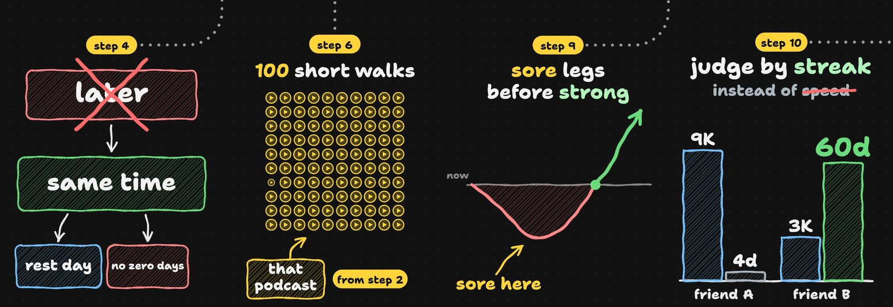

# reel-editor


https://github.com/user-attachments/assets/f22f6d04-c352-481f-9c6f-5d3ca7e3079f


A Claude Code skill that edits raw talking-head phone takes into finished Instagram Reels, TikToks and YouTube Shorts.

Drop in your clips and say "edit my reel". Claude picks the takes, plans the edit and checks its own frames; the scripts
do the cutting, captions, motion, sound and quality checks. Everything runs on your Mac and costs nothing.



*Four scenes from a Drawn Roadmap, the default format.*

## What it does

1. **Cuts to the speech.** Finds where you're actually talking (not room hum, breaths or lip smacks), drops flubs and
   retakes, and refuses to leave a pause over a quarter of a second.
2. **Captions every word as you say it**, above your face and clear of Instagram's buttons.
3. **Shows what you're talking about on the word you say it:** app screens rendered as 3D phones, your own screen
   recordings, b-roll, handwritten notes, neon titles and icons.
4. **Keeps it moving:** head tracking, slow pushes, 22 transitions, 12 title animations, none repeating back to back.
5. **Does the sound:** your voice kept as recorded in stereo, effects that each have one job, a beat that drops on the
   reveal, mastered to -12 LUFS.
6. **Makes one reel per hook** so you can test them, plus a cover, the caption and a phone-sized copy.
7. **Checks itself:** frame count, loudness, dead air, pacing, silent moves, repeated effects, and the voice against the
   original recording.

## Formats

Say the name of the one you want. If you don't, you get a Drawn Roadmap.

| Format | What you get | Say |
|---|---|---|
| **Drawn Roadmap** (default) | A number counts up on a graph in the hook, then a hand-drawn canvas the camera flies across, one drawing per step, landing on your words, with your face cut back in for the lines that need it | "edit my reel", "draw the steps" |
| **Talking Head** | Your takes with captions, app screens as 3D phones, titles, transitions and sound effects | "make it a Talking Head", "show the app when I say it" |
| **Split Screen** | Your face full frame for the hook, then the drawing above your face for each point, with the word you're saying highlighted | "make it a Split Screen" |

A Drawn Roadmap needs at least two points to draw and a number in the hook. Without both, Claude makes a Talking Head and
tells you why.


*A Talking Head, from the test reel in this repo. The speaker is drawn, so nobody's face is in it.*

### Looks for a Talking Head

| Look | What you get |
|---|---|
| **Cinematic** (default) | Contrasty grade, glowing titles, 3D phones, a transition on most cuts, a beat that drops on the reveal |
| **Bright** | Your room bright and natural, bouncy cuts, mixed caption styles, no music |

### Art styles for the drawings

| **Sketch** (default) | **Blueprint** | **Neon** | **Stick Figures** |
|---|---|---|---|
| Hand-drawn on dark | White technical lines on blue | Glowing tubes on black | White marker on black |


Sketch draws whole reels. The other three come with sample scenes to build on.

## Install

```bash
claude plugin marketplace add adrianpartain59/reel-editor
claude plugin install reel-editor@reel-editor
```

Or copy `skills/reel-editor/` into `~/.claude/skills/`.

It needs a Mac (it uses Apple's Vision framework and system fonts) with:

```bash
brew install ffmpeg whisper-cpp node
python3 -m pip install pillow numpy
xcode-select --install
mkdir -p ~/.cache/whisper.cpp && curl -L -o ~/.cache/whisper.cpp/ggml-large-v3-turbo.bin https://huggingface.co/ggerganov/whisper.cpp/resolve/main/ggml-large-v3-turbo.bin
```

and Google Chrome for the app mockups. Node draws the Drawn Roadmap and the Split Screen. The whisper model is 1.6 GB; a smaller one works
with less exact word timings (`REEL_WHISPER_MODEL` points at any ggml file). Ask Claude to "check the reel-editor setup",
or run `python3 skills/reel-editor/scripts/doctor.py`, to see what's missing.

## Use

> Edit my reel. HOOK_A.mov and HOOK_B.mov are two hooks, TAKE_1 to TAKE_4 are the body. Here's the script: ...

> Show the onboarding screen when I say "like this", and hold it longer

> Here's a ten-step list I recorded, draw the steps

> Make this one a Split Screen, here's the full take

> I like how this reel is edited, make mine look like that (screen recording attached)

A 40 s Talking Head takes about 5 minutes to render.

## Your own rules

Tell Claude how you want your reels and it keeps your rules in `~/.config/reel-editor/preferences.md`. They win over the
skill's defaults and survive updates. Your own looks go in `~/.config/reel-editor/looks/` and rooms for background
replacement in `~/.config/reel-editor/rooms/`.

## Sound and music

The sound effects are synthesized by `scripts/sfx_pack.py`, so there is nothing to license. You can put your own recordings
over them ([how](skills/reel-editor/references/sfx-library.md)).

The beats aren't in this repository: Mixkit's free licence lets you use them in your videos but not hand the files on.
`python3 scripts/music_lib.py fetch` downloads your own copies (33 MB). Until then a Talking Head plays a
synthesized pad and a Drawn Roadmap has no beat.

## Scripts

All of them also work without Claude.

| Script | Does |
|---|---|
| `ingest.py`, `utterances.py` | Finds the speech, transcribes it with word timings, finds the face |
| `cut.py`, `speechmap.py` | Cuts the takes to the speech, white balance, gentle grade |
| `mockups.py` | App screens as transparent phones, from one HTML file |
| `compose.py`, `fx.py` | Renders a Talking Head from `plan.json`, or stills of any moment |
| `mix.py`, `audiomap.py`, `sfx_pack.py`, `music.py` | Voice, effects, beat, master |
| `qa.py`, `audio_check.py` | The checks |
| `countup_hook.py`, `canvas_body.py`, `canvas_sound.py` | Drawn Roadmap |
| `split_cut.py`, `split_reel.py`, `split_thumb.py` | Split Screen |
| `analyze_ref.py` | Measures a reference reel: pacing, zooms, loudness, caption sheets |
| `room.py` | Replaces the room behind you, no green screen |

## Test it

```bash
tests/run.sh
```

Makes takes of a drawn speaker with a macOS voice (one has a flub in it), edits them into a reel, runs the checks and
draws the starter scenes. About 4 minutes.

## Good to know

- Built for vertical talking-head video of one person, face and shoulders in frame, in English.
- Claude can't hear. Sound is checked by measurement only, so listen before you post.
- The app mockups are for fictional apps. Don't put a real company's name or a made-up review of a real product on them.
- Macs only: fonts, face finding and person masks come from macOS.

MIT licensed. The drawings use [@napi-rs/canvas](https://github.com/Brooooooklyn/canvas) (MIT) and open-licence
Google fonts, installed from npm.
